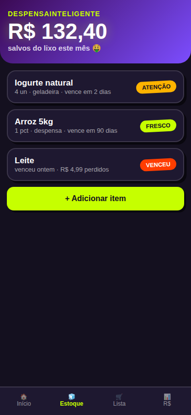

# 🧊 DespensaInteligente — chega de jogar comida (e dinheiro) fora

App Android **offline-first** que guarda sua despensa com validade, **avisa antes de vencer**, gera a **lista de reposição sozinho** e mostra o **desperdício evitado em R$**. Irmão do [ListaCompras](https://github.com/Regimarcilio/Projeto_ListaCompras) — ele cuida da ida ao mercado, este cuida da volta. **100% open-source, sem conta, sem rastreio.**

  

*Acima: prévia da identidade (`docs/preview.html`) — semáforo FRESCO/ATENÇÃO/VENCEU e hero em R$.*

## ✨ O que já funciona (MVP v0.8)
- 📦 Estoque com busca, filtros por local e foto do item
- 🚦 Semáforo de validade + notificações locais (3 dias, 1 dia, no dia)
- 👆 Baixa em 1 gesto (consumir/descartar) com valor registrado
- 🛒 Lista de reposição que **cola pronta no ListaCompras**
- 💰 Tela R$ — salvos vs perdidos no mês · 💾 backup JSON · 🌗 claro/escuro (Sistema/Claro/Escuro)

## 🗺️ Status: MVP pronto ✅ → Sprint 5: barcode + sync

`docs/` tem visão, benchmarks, SRS, backlog e identidade.

## 📱 Como Baixar o APK para Instalação no Celular

O APK pode ser baixado e instalado diretamente no seu Android:

1. **Baixar o APK pronto nas Releases:**  
   Acesse a seção [GitHub Releases](https://github.com/Regimarcilio/DespensaInteligente/releases) e baixe o arquivo `Despensa-v0.8-debug.apk` disponível em **Assets**.
2. **Instalação no Android:**  
   Ao terminar o download, abra o arquivo no celular. Se solicitado, autorize "Permitir instalação desta fonte" nas configurações do Android e confirme a instalação.
3. **Compilação Automática (GitHub Actions):**  
   O repositório conta com workflow em `.github/workflows/build-apk.yml`, que compila automaticamente o APK Kotlin/Compose em `apps/mobile/Despensa` e disponibiliza para download.
4. **Instalação PWA (Sem APK):**  
   Você também pode abrir a versão Web no Chrome do Android e clicar em "Instalar" para adicionar à tela inicial sem precisar gerenciar arquivos APK.

Veja o guia detalhado em [`docs/como-baixar-e-gerar-apk.md`](docs/como-baixar-e-gerar-apk.md).

## 🤝 Contribuir

Toda demanda vira **issue** antes de virar código. PRs com `Co-authored-by` são bem-vindos (pareamento de verdade!). **Se a ideia te ajuda, deixe uma ⭐ — é o que mantém o projeto vivo.**
